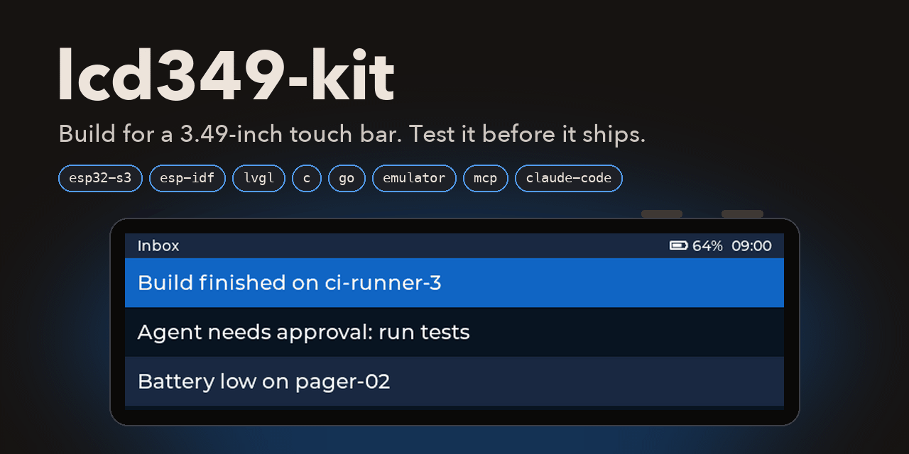
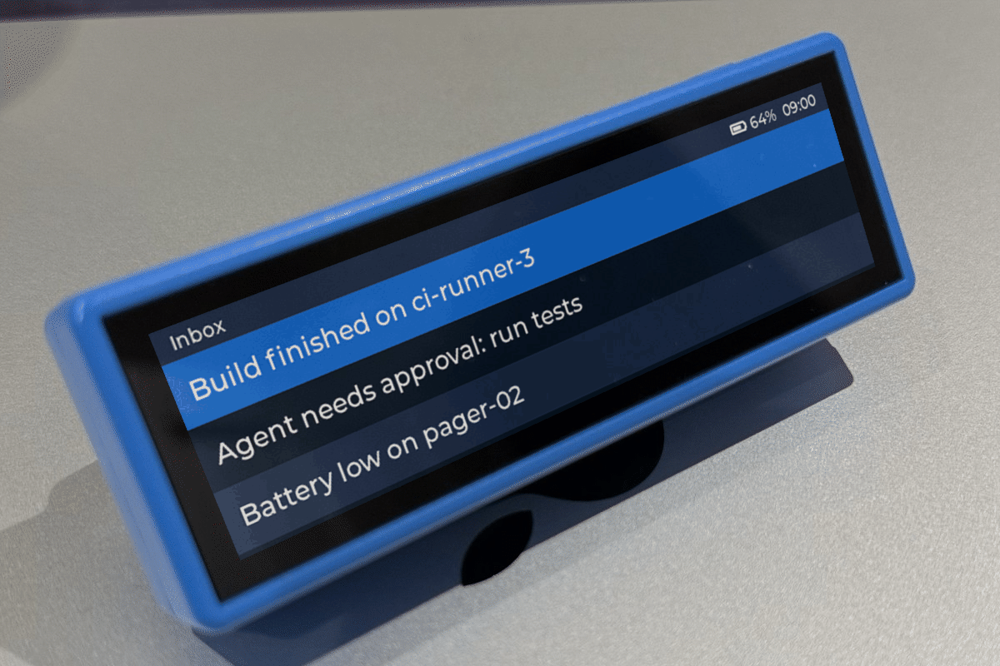

<div align="center">



**Write it once. Run it on the board, or on your Mac.**

An SDK, an emulator and a Claude Code plugin for the [Waveshare ESP32-S3-Touch-LCD-3.49](docs/hardware.md), a long, thin touch bar with two buttons, a speaker and a battery. Write a product once in ESP-IDF C with LVGL 9. Build it for the board, and for an emulator that runs the same code on your computer. Then drive it the same way, whether you're a person at the window, a script in CI or an agent in Claude Code.

[Status](#status) · [See it](#see-it) · [How it works](#how-it-works) · [Claude Code](#claude-code) · [Quick start](#quick-start-for-people) · [What it doesn't model](#what-the-emulator-doesnt-model) · [Planned](#planned) · [Docs](#documentation) · [Develop](#develop)

</div>

## Status

**v0.2.0 is the first public version.** Each release has `lcd349` and `lcd349-view` for macOS on Apple Silicon and Linux on x86_64, with a `SHA256SUMS` file and a GitHub build attestation for every binary. The C API can still change before 1.0. On the board, light sleep is still experimental (see the [changelog](CHANGELOG.md)).

## See it

<div align="center">



<sub>The gallery example, the template and the inputs example, as the board shows them: the emulator's golden screenshots set into a photo of the board.</sub>

</div>

## How it works


- **The SDK** (`components/lcd349`): an ESP-IDF component with a small C API for everything physical: the display and backlight, touch, the two buttons and a gesture classifier, power and sleep, the battery, tones, the clock, storage, Wi-Fi and the USB console. The UI is plain LVGL 9.
- **The emulator:** your unchanged product, built for ESP-IDF's `linux` target. It models the screen, its timing, touch, buttons, power states, battery, storage and Wi-Fi. It runs headless; `lcd349-view` shows it at physical size, in its case.
- **`lcd349`**, one Go binary: build, run and supervise instances; screenshots, the UI tree, a lint that knows the board's design rules, touch and buttons; scenarios with golden screenshots; and the MCP server for agents.
- **The Claude Code plugin:** the `lcd349` skill and the MCP server. [Below](#claude-code).
- **`device/device.json`:** every board fact, limit and design rule, with its source. One generator feeds it to the SDK, the emulator, the lint, the skill and these docs.

## Claude Code

Ask Claude Code for a screen, and it designs it on the board's grid, builds it, runs it in the emulator, looks at the screenshot, fixes what the lint finds, and leaves you a scenario that keeps it working.

### Install

```
/plugin install lcd349 --marketplace MaverickHQ/lcd349-kit
```

That needs Claude Code 2.1.275 or later. On an older version, add the marketplace first:

```
/plugin marketplace add MaverickHQ/lcd349-kit
/plugin install lcd349@lcd349-kit
```

From a shell: `claude plugin install lcd349 --marketplace MaverickHQ/lcd349-kit`.

### What you get

One skill and one MCP server. No slash commands, agents or hooks.

#### The skill: `lcd349`

**It starts by itself** when you ask for a screen, app or UI for this board; when your project's `idf_component.yml` names `lcd349`; when the lcd349 tools are available; or when you plan how a product uses the buttons, touch, sleep and power. **Call it yourself** with `/lcd349:lcd349`.

**It knows** the board's facts and limits, the design rules the lint checks, the button grammar (short press steps, hold commits, no boot-time BOOT combos) and the recipes for common screens. It works in [seven steps](#how-a-session-goes) and doesn't call a UI done until it has handed you the hardware checklist.

| Its references | What |
|---|---|
| [device.md](plugin/skills/lcd349/references/device.md) | every board fact, limit and rule, and what's unmeasured |
| [design-guide.md](plugin/skills/lcd349/references/design-guide.md) | layout bands, sizes, type, colour, touch, buttons, motion, sleep |
| [recipes.md](plugin/skills/lcd349/references/recipes.md) | status bar, list, card, tiles, confirm, toast, hold to confirm, setup |
| [sdk-api.md](plugin/skills/lcd349/references/sdk-api.md) | the C API, from the headers |
| [scenarios.md](plugin/skills/lcd349/references/scenarios.md) | scenario files, goldens, staying deterministic |
| [fidelity.md](plugin/skills/lcd349/references/fidelity.md) | what the emulator doesn't model |
| [hardware-checklist.md](plugin/skills/lcd349/references/hardware-checklist.md) | flashing, and what to check on the board |
| [troubleshooting.md](plugin/skills/lcd349/references/troubleshooting.md) | build errors, crashes, hangs, missed touches, golden mismatches |

#### The MCP server: `lcd349`, 17 tools

Started by the plugin as `lcd349 mcp`, over stdio. It acts on emulator instances in your working folder.

| Job | Tool | What it does |
|---|---|---|
| Learn | `device_info` | facts, limits, rules, what isn't modelled |
| Make | `new_project` | a project from the template, in the workspace |
| | `build` | errors with file, line and a kit hint |
| Run | `run` · `stop` | an instance, headless unless `window` |
| | `power` | on, off, reset, download mode |
| See | `screenshot` | PNG, at physical size if asked |
| | `ui_tree` | every object's size, text, font, colour |
| | `logs` | the serial output, with a cursor |
| | `record` | start, then stop for a GIF |
| Act | `touch` | tap, long press, swipe |
| | `press` | BOOT, PWR or both, for a time |
| | `set_state` · `get_state` | battery, power source, Wi-Fi, clock, board revision |
| Check | `ui_lint` | the design rules; each finding has a fix |
| | `wait` | for a log line, text, or a settled screen |
| | `run_scenario` | per-step results; golden, actual and diff images |

### How a session goes


Things to ask it:

> **Build:** Use the lcd349 skill. Make an app with a list of three messages; tapping one, or holding BOOT on it, opens it as a card; PWR goes back.

> **Fix:** The `tests/app.scenario.yaml` run fails on `goldens/home.png`. Show me the diff, tell me whether the screen or the golden is wrong, and fix the one that is.

> **Test a state:** Set the battery to 8 % on battery power and take Wi-Fi away. Check the status bar warns about both, then bring Wi-Fi back and check it recovers. Add it as a scenario.

### What it runs, and what to trust

- The plugin's launcher uses the `lcd349` on your PATH if its version matches the plugin's. If not, it downloads that version's release binary over HTTPS and refuses to run it unless its SHA-256 is in the plugin's `checksums.txt`.
- The MCP server talks to Claude Code over stdio. Nothing in the kit opens a network port: each emulator instance answers on a Unix socket only you can open.
- The tools act on emulator instances only; none of them flashes a board. Flashing is yours, and the skill tells you how.
- More in [docs/security.md](docs/security.md).

### What your machine needs

| For | You need |
|---|---|
| Everything | [ESP-IDF](docs/getting-started.md#esp-idf) v5.5.6 (every build uses its `linux` target); on Linux, `libbsd-dev` |
| The window | CMake, Ninja, SDL2 and pkg-config |
| Building `lcd349` from source | Go |
| The plugin's download | `curl`, and `shasum` or `sha256sum` |

`lcd349 doctor` checks all of this and says how to fix what's missing.

## Quick start, for people

Install `lcd349` from the release (macOS on Apple Silicon shown; on Linux x86_64 use `linux_amd64`):

```
V=0.2.2; A=darwin_arm64
curl -fLO https://github.com/MaverickHQ/lcd349-kit/releases/download/v$V/lcd349_${V}_$A
curl -fLO https://github.com/MaverickHQ/lcd349-kit/releases/download/v$V/SHA256SUMS
shasum -a 256 -c --ignore-missing SHA256SUMS
gh attestation verify lcd349_${V}_$A --repo MaverickHQ/lcd349-kit   # optional: built by this repository's CI
install -m 755 lcd349_${V}_$A ~/bin/lcd349
```

Or build it from a checkout: `go build -o ~/bin/lcd349 ./cmd/lcd349`. That's the way on an Intel Mac or on Linux arm64, which have no release binary.

```
lcd349 doctor                                # checks everything, and says how to fix what's missing
lcd349 new ~/bar-demo                        # pins this release of the kit
cd ~/bar-demo
lcd349 run                                   # builds it and opens the window: click to touch, hold b or p for the buttons
```

From a second terminal, while it runs:

```
lcd349 shot                                  # bar-demo.png
lcd349 touch tap 520 86 && lcd349 wait --log "count 1"
lcd349 lint                                  # the design rules: 0 errors
lcd349 scenario tests/app.scenario.yaml      # the project's own check, against its golden screenshot
```

[Getting started](docs/getting-started.md) goes further, including building for the board.

## What the emulator doesn't model

<!-- BEGIN GENERATED by internal/devicegen from device/device.json; edit the template, not this block -->
The emulator runs your unchanged product on the board's 640 × 172 screen (about 86 × 23 mm), with its rotation, RGB565 colour, full-frame flush time, single-point touch, two buttons, power states, battery, storage and 2.4 GHz Wi-Fi. It doesn't model these, so check each one your product depends on on the board:

- **CPU speed and cycle timing.** Time heavy work (parsing, crypto, big redraws) on the board; the emulator runs at host speed.
- **Cache and PSRAM bandwidth.** Check frame rates and large copies on the board.
- **Radio behaviour (range, interference, roaming, real signal strength).** Join your real networks, including a 2.4 GHz phone hotspot, and walk out of range.
- **Brown-outs and supply dips.** Run on a low battery with Wi-Fi and audio active.
- **Flash wear and NVS write limits.** Count storage writes per hour; avoid writing on every event.
- **Speaker loudness and tone quality.** Listen to every tone on the board, in the case.
- **Touch feel: finger size, accuracy at the edges, touch through the case.** Use every touch target with a finger on the board, in the case.
- **Task scheduling: one simulated core instead of two, host threads switched at the FreeRTOS tick, and the kit's own tasks at app_main's priority.** Test task priorities, timing races and core pinning on the board. In the emulator, avoid malloc and printf from tasks above priority 1 that share them with lower ones: a host lock can hang the instance.
- **Network access follows the host, not the simulated Wi-Fi: sockets work even while the simulated station is disconnected.** Check that the product waits for LCD349_WIFI_CONNECTED before connecting, and recovers when Wi-Fi drops.

Some board facts aren't measured yet (6, listed in [docs/hardware.md](docs/hardware.md)); until they are, the emulator uses a stand-in for each or doesn't model it.
<!-- END GENERATED -->

## Planned

The kit doesn't cover all of the board yet. Still to come, in the SDK and the emulator:

- motion, from the QMI8658 IMU;
- the two microphones;
- the TF card;
- Bluetooth LE;
- USB device mode on the Type-C port;
- the external antenna.

## Documentation

| Page | What |
|---|---|
| [Getting started](docs/getting-started.md) | install, a first product, the window, scenarios, the board build, adding the kit to an existing project |
| [The SDK](docs/sdk.md) | threads, the LVGL lock, callbacks, errors, power and sleep; with the [API reference](docs/sdk-api.md) |
| [The emulator](docs/emulator.md) | how it runs your product, instances, the viewer, the serial port, the control protocol, limits |
| [Scenarios](docs/scenarios.md) | scripted checks with golden screenshots, in CI too |
| [The plugin](docs/plugin.md) | the skill and the MCP tools for Claude Code, and how the plugin finds its binary |
| [Hardware](docs/hardware.md) | every board fact, with its source (generated) |
| [ESP-IDF components in the emulator](docs/emulator-components.md) | what the emulator lacks, and the kit call to use instead (generated) |
| [Security](docs/security.md) | what the tools do on your machine, and what to trust |
| [Measurements](docs/measurements.md) | the speed and stability budgets, measured |
| [Framework adapters](docs/adapters.md) | why it's ESP-IDF and C for now, and how another stack gets support |
| [Decisions](docs/adr/) | the power latch, reading touch, polling touch |
| [Contributing](CONTRIBUTING.md) | issues are welcome; pull requests aren't, for now |
| [Changelog](CHANGELOG.md) | what changed in each version |
| [Third-party licences](THIRD_PARTY.md) | LVGL, the Espressif components, the fonts and the Go modules |

The skill's references are good reading for people too: the [design guide](plugin/skills/lcd349/references/design-guide.md), the [recipes](plugin/skills/lcd349/references/recipes.md) and [troubleshooting](plugin/skills/lcd349/references/troubleshooting.md).

## Develop

```
go vet ./... && go test ./...                          # unit tests (integration tests skip what isn't built)
go run ./internal/devicegen                            # after editing device/device.json, a skill template, a header or a gallery recipe
go run ./internal/devicegen --check                    # the generated files are current (CI runs it)
for ex in examples/*/; do go run ./cmd/lcd349 build -C $ex; done
LCD349_REQUIRE_IDF=1 LCD349_REQUIRE_VIEWER=1 LCD349_REQUIRE_EXAMPLES=1 LCD349_TEMPLATE_BUILD=1 \
  go test ./...                                        # as CI runs them: nothing skips
cd components/lcd349/test_apps/host && idf.py --preview build && ./build/lcd349_host_test.elf   # sdkconfig.defaults sets the linux target
cmake -S viewer -B viewer/build && cmake --build viewer/build && viewer/build/lcd349-view-tests
go run ./tools/boardtest [-only <subsystem>]           # the SDK's tests on a board plugged in over USB (test_apps/board)
uv run tools/media/art.py                              # after a golden changes: the README's art, on macOS (CI checks it's current)
```

From a checkout, point new projects and the plugin at your working copy, with the `lcd349` you built on PATH:

```
lcd349 new ~/bar-demo --kit-path components/lcd349
LCD349_KIT_PATH=$PWD/components/lcd349 claude --plugin-dir plugin
```

CI runs all of this but the board tests on every push (`.github/workflows/ci.yml`): Linux in the pinned ESP-IDF container, and the viewer and Go on macOS. A tag runs `.github/workflows/release.yml`. The requirements and the design, with its decisions, are in `.kiro/specs/lcd349-kit/` ([requirements.md](.kiro/specs/lcd349-kit/requirements.md), [design.md](.kiro/specs/lcd349-kit/design.md)).

---

Not affiliated with Waveshare or Anthropic. Apache-2.0 ([LICENSE](LICENSE)); third-party licences are in [THIRD_PARTY.md](THIRD_PARTY.md).
